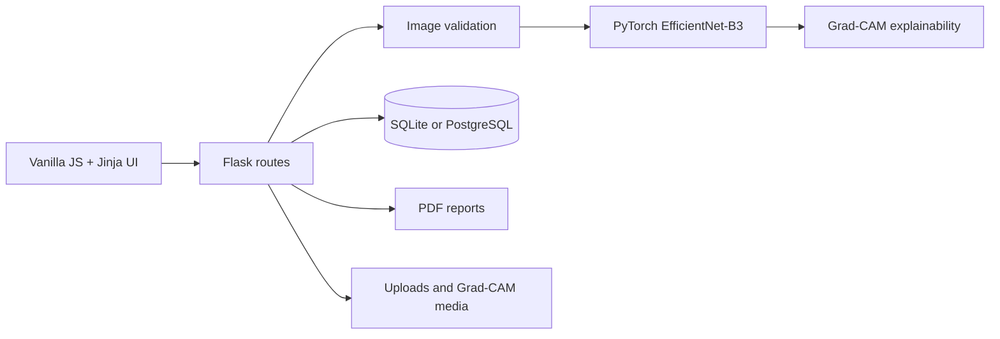

# AnemiaVision AI

> Hospital-grade anemia screening powered by EfficientNet-B3 deep learning plus Grad-CAM explainability.


## Live Demo

- Vercel UI demo: https://anemia-detection-kru8.vercel.app/
- Note: the Vercel demo serves the lightweight frontend only. The full prediction app needs the Docker deployment because it loads PyTorch plus the trained model checkpoint.


## What's New (UI v2.0)

- Complete UI redesign with a glassmorphism dark medical theme
- Animated particle background, floating orbs, cursor glow, and page transitions
- Drag-and-drop image upload with live preview and local image quality hints
- Mobile-first camera capture workflow with rear-camera preference
- Animated Grad-CAM comparison slider on result pages
- Redesigned analytics dashboard with Chart.js dark-mode charts
- Modern history grid/list toggle with filters, confidence bars, and CSV export
- Full IntersectionObserver scroll animations and animated counters

## Quick Start

```bash
python -m venv .venv
.venv\Scripts\activate
pip install -r requirements.txt
python app.py
```

Open `http://127.0.0.1:5000`.

To validate the dataset before training:

```bash
python utils/check_dataset.py
```

To run with Docker:

```bash
docker compose up --build
```

## Screenshots

- Home page screenshot placeholder
- Scan workflow screenshot placeholder
- Result and Grad-CAM comparison screenshot placeholder
- History dashboard screenshot placeholder
- Analytics dashboard screenshot placeholder

## How It Works

1. Capture or upload a smartphone image of the eye conjunctiva or fingernail.
2. Validate image quality and reject unsupported formats.
3. Run the EfficientNet classifier and calibrated probability pipeline.
4. Generate a Grad-CAM overlay to show the AI focus region.
5. Save the scan, display risk guidance, and export a PDF report.

Dataset folders are discovered flexibly across common class naming variants:

```text
dataset/
├── train/
│   ├── anemic/
│   └── non-anemic/
├── valid/
│   ├── Anemia/
│   └── Non_Anemia/
└── test/
    ├── Anemic/
    └── Non-anemic/
```

## Architecture



## Training

Start a fresh training run:

```bash
python train.py
```

Resume from a checkpoint:

```bash
python train.py --resume models/last_checkpoint.pth
```

Evaluate the trained model:

```bash
python evaluate.py --split test
```

Artifacts are saved under `models/` and `logs/`.

## API Reference

### `POST /api/predict`

JSON request:

```json
{
  "image": "<base64-image-or-data-uri>",
  "patient_name": "Aarav Kumar",
  "age": 25,
  "gender": "Male",
  "phone": "9999999999",
  "image_type": "Eye Conjunctiva",
  "notes": "Fatigue for 2 weeks"
}
```

Success response:

```json
{
  "success": true,
  "scan_id": 42,
  "public_scan_id": "AV-000042",
  "prediction": "Non-Anemic",
  "confidence": 0.912,
  "risk_level": "Low Risk",
  "gradcam_url": "/media/gradcam/scan_042.jpg",
  "result_url": "/result/42",
  "pdf_url": "/export/pdf/42"
}
```

Notes:

- Base64 payloads may be raw strings or data URIs.
- Prediction endpoints are rate-limited per IP.
- Uploads are optimized before inference and storage.

## Tech Stack

| Layer | Technology |
|-------|------------|
| Frontend | Vanilla JS, CSS3, Chart.js |
| Backend | Flask, Gunicorn |
| AI Model | PyTorch, torchvision, EfficientNet-B3 |
| Database | SQLite / PostgreSQL |
| Reports | ReportLab |
| Deployment | Docker, Render, Vercel entrypoint |

## Deployment

### Free Working Deployment: Render

Use `render.yaml` to provision a free Docker web service and a free Render Postgres database:

1. Push this repository to GitHub.
2. In Render, choose **New > Blueprint** and select this repository.
3. Let Render create the web service and database from `render.yaml`.
4. After deploy, open `/health`. It should show `"checkpoint_available": true` and `"database_backend": "postgresql"`.

Render Free works for demos, but it sleeps when idle and can take about a minute to wake up. Its filesystem is temporary, so this app also stores uploaded scan images and Grad-CAM images in Postgres for history pages.

Render Free Postgres currently expires after 30 days. For longer-lived history at no app-code cost, create a free Supabase or Neon Postgres database and set the Render web service `DATABASE_URL` to that external connection string.

### Paid/Production Render

For a production-style Render deployment, upgrade the web service/database and attach a disk. Set:

```text
ANEMIA_RUNTIME_ROOT=/var/data/anemiavision
DATABASE_URL=<postgres connection string>
FLASK_SECRET_KEY=<long random secret>
```

### Vercel

The repository includes `api/index.py` and `vercel.json` for a Flask serverless UI entrypoint. It intentionally does not run prediction or history storage. Vercel Python functions are size and request-body limited, and this project includes PyTorch plus model files, so Vercel is best kept as a UI/demo link. Use the Render Docker URL as the real working website.

### Production Command

```bash
gunicorn --bind 0.0.0.0:5000 --workers 2 app:app
```

Health check:

```text
GET /health
```

## Disclaimer

AnemiaVision AI is for screening assistance only. It is not a clinical diagnostic tool and does not replace professional medical evaluation, CBC testing, or physician judgment.


---

# VYRA — AI/ML, Hemoglobin Estimation & Evaluation (Person 2)

## Architecture Overview

VYRA upgrades the baseline classifier into a **Multimodal Dual-Head Learning Architecture**:
- **Visual Backbone**: EfficientNet-B3 with ImageNet pretraining.
- **Feature Fusion (285 dimensions)**:
  - 256-dim visual representation (AdaptiveAvgPool + BatchNorm + GELU + Dropout)
  - 27-dim camera-invariant handcrafted colorimetric features (Redness index, pallor ratios, channel stats, spatial gradients, local variance)
  - 2-dim anatomical body-part encoding (`[1, 0]` for conjunctiva, `[0, 1]` for fingernail)
- **Head A (Classification)**: Anemia risk probability with post-hoc temperature scaling ($T = 1.3392$).
- **Head B (Hemoglobin Regression)**: Continuous estimated Hb in g/dL with strictly positive output via Softplus, stabilized by clinical mean bias initialization ($10.75\text{ g/dL}$).
- **Masked Dual Loss**: $\mathcal{L}_{total} = 0.70 \cdot \mathcal{L}_{CE} + 0.30 \cdot \mathcal{L}_{\text{SmoothL1}}$ with unlabelled samples excluded from regression backpropagation.

## Performance Verification Summary (Champion Model)

| Metric | Baseline | Champion Model (Ours) | Improvement |
| :--- | :---: | :---: | :--- |
| **Continuous Hb MAE** | 3.43 g/dL | **2.06 g/dL** | **-39.9% error reduction** |
| **Continuous Hb RMSE** | 3.87 g/dL | **2.64 g/dL** | **-31.8% error reduction** |
| **Bland-Altman Bias** | -3.04 g/dL | **+0.17 g/dL** | Underestimation eliminated |
| **Test Accuracy** | 58.44% | **63.90%** | **+5.46% gain** |
| **Triage Sensitivity** | 53.95% | **67.43%** | **+13.48% sensitivity** |
| **ROC-AUC** | 0.5816 | **0.6639** | **+0.0823 discriminative gain** |

## Reproducible Commands

### 1. Dataset Scan, Duplicate Audit & Patient Splitting
```bash
python src/data/inventory_and_split.py
```
Outputs:
- `data/manifests/dataset_inventory.csv`
- `data/manifests/duplicate_audit.csv`
- `data/splits/train.csv` (70%)
- `data/splits/validation.csv` (10%)
- `data/splits/test.csv` (20%)

### 2. Baselines & Champion Model Training
```bash
python scripts/run_baselines_and_experiments.py
```
Saves best model weights to `checkpoints/best_dual_head.pth` based strictly on validation split performance.

### 3. Test Set Evaluation & Diagnostics
```bash
python src/evaluation/evaluate_model.py
```
Generates:
- `evaluation/metrics/champion_test_report.json`
- `evaluation/plots/champion_confusion_matrix.png`
- `evaluation/plots/champion_bland_altman.png`

### 4. Run Unit and Integration Tests (12 Tests)
```bash
python tests/test_vyra_pipeline.py
```

### 5. Run Python Inference (Person 3 API Contract)
```python
from src.inference.predictor import predict

result = predict(
    image="data/raw/cp_anemic/CP-AnemiC/Anemic/Image_001.png",
    body_part="conjunctiva"
)
print(result)
```
