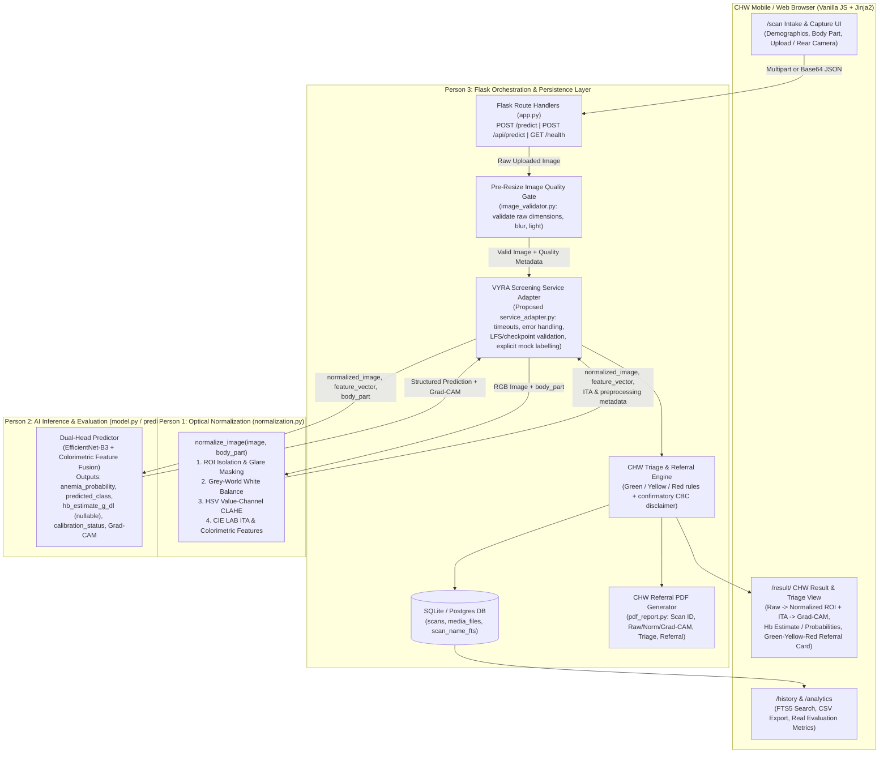

# VYRA — Person 3, Phase 2: Architecture & Codebase Audit (`PERSON3_PHASE2_ARCHITECTURE.md`)

## 1. Actual Repository Structure

The application repository is located at `C:\Claude_projects\Vyra\anemia-detection` (cloned from `https://github.com/RAHULPATEL2002/anemia-detection.git`, branch `feature/vyra-integration`, with `Tanish` also pointing to `HEAD`).

```text
C:\Claude_projects\Vyra\anemia-detection\
├── .gitattributes                 # Git LFS rules for models/20260428_2028_*.pth
├── .gitignore                     # Ignores .venv/, database/*.db, reports/*.pdf, logs/*.log
├── .python-version                # Specifies 3.12 (verified running under Python 3.11 .venv)
├── app.py                         # Main Flask application, ORM models, routes, rate limiter (1,729 lines)
├── config.py                      # Central configuration, paths, device/profile resolution (451 lines)
├── dataset.py                     # Split/class folder discovery, transforms, DataLoaders (478 lines)
├── evaluate.py                    # Test/validation evaluation & plot generation script (377 lines)
├── gradcam.py                     # TemperatureScaler & Grad-CAM hook/overlay generator (366 lines)
├── image_validator.py             # OpenCV quality gate: format, size, blur, brightness (206 lines)
├── migrate.py                     # DB readiness poller & table creation helper (97 lines)
├── model.py                       # EfficientNet-B0/B3 binary classifier builder & loader (188 lines)
├── pdf_report.py                  # ReportLab A4 PDF screening report generator (260 lines)
├── predict.py                     # AnemiaPredictor, PredictionResult, risk/advice helpers (363 lines)
├── schema_patches.py              # Idempotent ALTER TABLE patch for scans.deleted_at (36 lines)
├── storage_utils.py               # Portable path resolution for uploads/ and gradcam/ (76 lines)
├── train.py                       # Training pipeline with Mixup, CosineAnnealingLR (795 lines)
├── requirements.txt               # Minimal Vercel UI manifest (only flask==3.0.3)
├── requirements-full.txt          # Full application dependency manifest (16 packages)
├── Dockerfile                     # Python 3.12-slim container build using requirements-full.txt
├── docker-compose.yml             # Local Docker service definition
├── entrypoint.sh                  # Runs migrate.py then Gunicorn
├── gunicorn.conf.py               # Gunicorn worker/timeout configuration
├── Procfile                       # Platform process definition
├── render.yaml                    # Render Docker + Postgres Blueprint
├── vercel.json                    # Routes Vercel serverless traffic to api/index.py
├── README.md                      # Upstream project README
├── TRAINING_GUIDE.md              # Notes that existing 3-epoch CPU model had ~45% val accuracy
├── HUGGINGFACE_DEPLOY.md          # Hugging Face Spaces Docker deployment notes
├── PERSON3_PHASE1_BASELINE.md     # Phase 1 baseline verification report
├── api/
│   └── index.py                   # Lightweight UI-only Flask app for Vercel (no PyTorch/DB)
├── deploy/
│   └── Caddyfile                  # Reverse proxy configuration
├── database/
│   └── anemia_vision.db           # Local SQLite database (auto-created at startup; git-ignored)
├── logs/
│   ├── dataset_preview.png        # Sample dataset grid image
│   ├── learning_rate_schedule.png # LR plot from prior 3-epoch run
│   ├── train_stderr.log           # Prior training stderr log
│   ├── train_stdout.log           # Prior training stdout log
│   ├── training.log               # Prior training log (shows 3 completed epochs on CPU)
│   ├── training_history.json      # 3-epoch metrics (val_acc=0.4486, val_auc_roc=0.5826)
│   ├── training_validation_accuracy.png
│   └── training_validation_loss.png
├── models/
│   ├── 20260428_2028_best_model.pth       # 134-byte Git LFS pointer file (BLOCKER)
│   ├── 20260428_2028_last_checkpoint.pth  # 134-byte Git LFS pointer file (BLOCKER)
│   └── temperature_scaling.json           # {"temperature": 3.0634281635284424}
├── reports/
│   └── anemiavision_report_1.pdf  # Sample generated ReportLab PDF report (282,202 bytes)
├── static/
│   ├── css/
│   │   ├── animations.css
│   │   ├── components.css
│   │   ├── main.css
│   │   └── pages/                 # analytics.css, author.css, history.css, index.css, result.css
│   ├── gradcam/
│   │   └── 20260412_213235_af19d6b1_gradcam_29b10e23.png
│   ├── js/
│   │   ├── analytics.js           # Chart.js rendering (contains hardcoded modality split ratios)
│   │   ├── background.js          # Canvas particle animation
│   │   ├── main.js                # Navbar, /health status poller, counters, history view toggle
│   │   ├── scroll-reveal.js       # IntersectionObserver animations
│   │   └── upload.js              # Upload dropzone, rear-camera capture, client quality check, /health poll
│   └── uploads/
│       └── 20260412_213235_af19d6b1.jpeg
├── templates/
│   ├── 404.html
│   ├── 500.html
│   ├── about.html
│   ├── analytics.html
│   ├── author.html
│   ├── base.html
│   ├── history.html
│   ├── index.html
│   ├── result.html
│   └── scan.html
└── utils/
    └── check_dataset.py           # CLI dataset integrity & preview grid generator
```

### Missing Files (Confirmed Not Present in Baseline Repository)
- `normalization.py` — Planned for Person 1; does not exist yet.
- `logs/evaluation/test_summary.json` and `logs/final_test_summary.json` — Referenced by `app.py:performance_overview()`, but neither file exists in the repository.
- Automated unit/integration test suite (`tests/`) — No `tests/` directory or `pytest` test files exist in the repository.

---

## 2. Existing Route Inventory & Contracts

All routes are registered inside `create_app()` in `app.py` (`lines 1294–1717`), and `app = create_app()` is instantiated at module import time (`line 1720`) followed immediately by `eager_load_predictor()` (`line 1721`).

| Route | HTTP Method(s) | Handler Function | Request Inputs | Response / Behavior | Verified Status |
| :--- | :--- | :--- | :--- | :--- | :--- |
| `/` | `GET` | `index()` | None | Renders `index.html` with `home_stats()`, `latest_scans(5)`, `performance_overview()`. | **200 OK** |
| `/dashboard` | `GET` | `dashboard_redirect()` | None | `302` redirect to `/`. | **302 -> 200 OK** |
| `/scan` | `GET` | `scan_page()` | None | Renders `scan.html` with `IMAGE_TYPE_OPTIONS` (`"Eye Conjunctiva"`, `"Fingernail"`, `"Unknown"`) and `GENDER_OPTIONS` (`"Female"`, `"Male"`, `"Other"`). | **200 OK** |
| `/predict` | `POST` | `predict_route()` | `multipart/form-data`: `patient_name`*, `age`*, `gender`*, `phone`, `image_type`, `notes`, plus `image` (file) or `captured_image_data` (base64 data URI). Rate-limited (10 req/min/IP). | If model not loaded or validation fails, flashes warning/error and redirects (`302`) to `/scan`. On success, persists `Scan` + `MediaFile`, renders `result.html` (`200`). | **Redirects to `/scan` (Blocker: model not loaded)** |
| `/api/predict` | `POST` | `api_predict()` | `application/json` (`image` or `image_data` base64 + patient fields) OR `multipart/form-data` (`image` file or `captured_image_data` + patient fields). Rate-limited (10 req/min/IP). | Returns `200` JSON prediction payload, `400` on validation/image error, `429` on rate limit exceeded, `503` when checkpoint missing or predictor not loaded. | **503 Service Unavailable (Blocker: LFS checkpoint)** |
| `/result/<int:scan_id>` | `GET` | `result_page(scan_id)` | URL param `scan_id` | Queries active `Scan` by ID (`404` if missing/archived), re-runs `assess_image_quality()`, renders `result.html`. | **200 OK** (verified with test row) |
| `/history` | `GET` | `history_page()` | Query params: `q`, `result`, `risk`, `start_date`, `end_date`, `sort`, `order`, `page` | Searches via SQLite FTS5 (`scan_name_fts`) + `ILIKE`, paginates (10/page), renders `history.html`. | **200 OK** |
| `/history/export/csv` | `GET` | `export_history_csv()` | Query params: `q`, `result`, `risk`, `start_date`, `end_date` | Streams `text/csv` attachment `anemiavision_history.csv`. | **200 OK** |
| `/history/delete/<int:scan_id>` | `POST` | `delete_scan(scan_id)` | URL param `scan_id` | Soft-deletes record by setting `record.deleted_at = datetime.utcnow()`, redirects (`302`) to `/history`. | **Verified in code** |
| `/analytics` | `GET` | `analytics_page()` | Query params: `start_date`, `end_date` | Computes KPI & chart series via `analytics_payload()`, renders `analytics.html`. | **200 OK** |
| `/export/pdf/<int:scan_id>` | `GET` | `export_pdf(scan_id)` | URL param `scan_id` | Generates `reports/anemiavision_report_<scan_id>.pdf` via ReportLab and serves as `application/pdf` attachment. | **200 OK** (verified with test row) |
| `/media/uploads/<path:filename>` | `GET` | `uploaded_media(filename)` | URL param `filename` | Serves file from `UPLOADS_DIR` (`static/uploads`) or falls back to `MediaFile` DB blob (`404` if missing). | **200 OK** |
| `/media/gradcam/<path:filename>` | `GET` | `gradcam_media(filename)` | URL param `filename` | Serves file from `GRADCAM_DIR` (`static/gradcam`) or falls back to `MediaFile` DB blob (`404` if missing). | **200 OK** |
| `/about` | `GET` | `about_page()` | None | Renders `about.html` with `dataset_overview()` and `performance_overview()`. | **200 OK** |
| `/author` | `GET` | `author_page()` | None | Renders `author.html`. | **200 OK** |
| `/health` | `GET` | `health()` | None | Returns `200` JSON readiness dictionary. | **200 OK** |

---

## 3. Trace of the Current Prediction Pipeline

### Step-by-Step Execution Path (`POST /predict` and `POST /api/predict`)

1. **Pre-Request Hook (`apply_prediction_rate_limit`, `app.py:1329–1353`):**
   - For non-prediction routes, triggers background thread `maybe_start_predictor_warmup()`.
   - For `predict_route` and `api_predict`, calls `enforce_rate_limit(request.endpoint)` using the `rate_limit_events` table (default limit: `10` requests per `60` seconds per IP). Exceeding the limit returns HTTP `429` JSON (for `/api/predict`) or flashes a warning and redirects to `/scan` (for `/predict`).
2. **Model Readiness Gate (`app.py:1471–1481`, `1512–1525`):**
   - Checks `if latest_available_checkpoint() is None:` -> returns `503` (`"No trained checkpoint is available yet."`) or redirects to `/scan`.
   - Checks `if not predictor_loaded():` -> calls `maybe_start_predictor_warmup()` and returns `503` (`"The AI model is still starting on this server. Please wait a few seconds and try again."`) or redirects to `/scan`.
   - **Critical Defect Identified:** When `get_predictor()` fails permanently (such as `UnpicklingError` on the Git LFS pointer file), `_predictor` remains `None` and `_predictor_load_error` is set to `"invalid load key, 'v'."`, but `/api/predict` and `/predict` never inspect `_predictor_load_error`—they tell the caller the model is "still starting" forever.
3. **Patient Metadata Validation (`validate_patient_payload`, `app.py:574–616`):**
   - Required fields:
     - `patient_name`: non-empty string.
     - `age` (or alias `patient_age`): integer in `0..120`.
     - `gender` (or alias `sex`): normalized via `normalize_gender_value()` (`f`/`female`/`woman` -> `"Female"`, `m`/`male`/`man` -> `"Male"`, `o`/`other`/`non-binary` -> `"Other"`); must be in `("Female", "Male", "Other")`.
   - Optional fields:
     - `phone`: string or `None`.
     - `notes`: string or `None`.
     - `image_type` (or alias `image_region`): must be in `("Eye Conjunctiva", "Fingernail", "Unknown")`; defaults to `"Unknown"` if omitted or unrecognized.
   - If `errors` is non-empty, `/api/predict` returns HTTP `400` with `{"success": False, "errors": errors}`.
4. **Image Decoding & Pre-Validation Resizing (`run_prediction_workflow`, `app.py:1209–1225`):**
   - Accepts either `uploaded_file` (`request.files.get("image")`) or `captured_image_data` (`payload.get("image")` / `payload.get("image_data")` / `request.form.get("captured_image_data")`).
   - Calls `save_uploaded_file()` or `save_base64_image()`, both of which invoke `optimize_and_save_image(image, destination)` (`app.py:454–482`).
   - **Critical Defect Identified:** `optimize_and_save_image()` applies `ImageOps.exif_transpose(image).convert("RGB")` and **immediately center-crops and resizes** (`ImageOps.fit`) the image to `TRAINING_CONFIG.image_size` (`224x224` on CPU `fast` profile; `300x300` on GPU `full` profile) *before* `validate_image()` or preprocessing runs!
     - Consequence 1: An uploaded image smaller than `100x100` (e.g., `50x50`) is upscaled to `224x224` before `validate_image()` runs, bypassing the minimum resolution check in `image_validator.py`.
     - Consequence 2: Center-cropping to `224x224` before Person 1's `normalization.py` runs can clip the ROI or surrounding epidermis needed for ITA skin-tone calculation.
5. **Image Quality Validation (`AnemiaPredictor.predict_image`, `predict.py:258–275`):**
   - Calls `validate_image(resolved_path)` (`image_validator.py:80–175`).
   - Rejects missing files, extensions not in `{.jpg, .jpeg, .png, .webp}`, unreadable images, or dimensions `< 100x100`.
   - Computes grayscale Laplacian variance (`blur_score`) and mean pixel intensity (`brightness_mean`):
     - `brightness_mean < 40.0` -> `image_quality = "Poor lighting"` + warning.
     - `blur_score < 100.0` -> `image_quality = "Blurry"` (if not already `"Poor lighting"`) + warning.
     - `brightness_mean > 240.0` -> appends overexposure warning.
6. **Model Inference & Temperature Scaling (`predict.py:277–292`):**
   - Transforms image with `eval_transform`: `Resize((256, 256))` (for 224 input) -> `CenterCrop((224, 224))` -> `ToTensor()` -> `Normalize(IMAGENET_MEAN, IMAGENET_STD)`.
   - Runs `self.model(input_tensor)` producing shape `[1, 2]` logits (`CLASS_NAMES = ("non-anemic", "anemic")`).
   - Divides logits by `self.temperature_scaler.temperature` (`3.0634` from `models/temperature_scaling.json`), then applies `torch.softmax(calibrated_logits, dim=1)`.
   - Maps `prediction` (`"Anemic"` or `"Non-Anemic"`) and `confidence` to `risk_level` (`"Low Risk"`, `"Low-Medium Risk"`, `"Uncertain"`, `"Possible Anemia"`, `"Medium Risk"`, `"High Risk"`) and a heuristic string `hemoglobin_estimate` (`"7-9 g/dL (estimated)"`, etc.).
   - **Note:** `patient_info` is passed into `predict_image()` (`predict.py:251`), but is **completely unused** inside `predict_image()`.
7. **Grad-CAM Generation (`predict.py:296–310`, `gradcam.py:330–366`):**
   - Hooks the last `nn.Conv2d` layer in `model.features`, backpropagates the predicted class logit, builds a side-by-side comparison PNG (`Original` + `Grad-CAM Overlay`), and saves it to `static/gradcam/<stem>_gradcam_<uuid8>.png`.
8. **Persistence (`create_scan_record`, `app.py:764–806`):**
   - Saves raw bytes of the uploaded image and Grad-CAM image into `media_files` (`MediaFile`) and inserts a `Scan` row into `scans`.
   - SQLite trigger `scans_ai` automatically indexes `patient_name` into `scan_name_fts`.
9. **Response Serialization (`build_prediction_response`, `app.py:1177–1206`, `1555–1563`):**
   - For `/api/predict`, returns HTTP `200` JSON with 26 top-level keys.
   - For `/predict`, renders `templates/result.html` with `scan`, `quality`, `pdf_url`, and WhatsApp/email share links.

---

## 4. Database and PDF Architecture

### Database Schema (`SQLite` default at `database/anemia_vision.db`, `PostgreSQL` optional via `DATABASE_URL`)

1. **`scans` table (`Scan` model, `app.py:111–137`):**
   - `id` (`INTEGER PRIMARY KEY`) — Formatted as `AV-000001` via `@property public_scan_id`.
   - `patient_name` (`VARCHAR(150) NOT NULL`)
   - `age` (`INTEGER NULL`)
   - `gender` (`VARCHAR(32) NULL`)
   - `phone` (`VARCHAR(32) NULL`)
   - `image_type` (`VARCHAR(40) NULL`) — Stores `"Eye Conjunctiva"`, `"Fingernail"`, or `"Unknown"`.
   - `image_path` (`VARCHAR(500) NOT NULL`) — Portable reference `uploads/<filename>`.
   - `gradcam_path` (`VARCHAR(500) NULL`) — Portable reference `gradcam/<filename>`.
   - `prediction` (`VARCHAR(32) NOT NULL`) — `"Anemic"` or `"Non-Anemic"`.
   - `confidence` (`FLOAT NOT NULL`) — Float in `[0.0, 1.0]`.
   - `risk_level` (`VARCHAR(20) NULL`)
   - `anemic_probability` (`FLOAT NOT NULL`)
   - `non_anemic_probability` (`FLOAT NOT NULL`)
   - `notes` (`TEXT NULL`)
   - `created_at` (`DATETIME NOT NULL`)
   - `deleted_at` (`DATETIME NULL`, added idempotently by `schema_patches.py`)
   - **Missing Columns for VYRA CHW Workflow:** No columns currently exist for continuous `hb_estimate_g_dl` (currently computed dynamically as a heuristic string property), `normalized_image_path`, `ita_angle` / `skin_tone_category`, `triage_category` (`Green`/`Yellow`/`Red`), `referral_status` / `referral_facility`, `chw_id` / `pregnancy_status`, or `model_version` / `is_mock`.
2. **`media_files` table (`MediaFile` model, `app.py:238–255`):**
   - Stores binary blobs (`kind` in `{"uploads", "gradcam"}`, `filename`, `content_type`, `data`, `created_at`) as a fallback when local files are missing on ephemeral hosts.
3. **`rate_limit_events` table (`RateLimitEvent` model, `app.py:94–108`):**
   - Tracks per-IP, per-endpoint request timestamps for sliding-window throttling.
4. **`scan_name_fts` virtual table (`app.py:669–707`):**
   - SQLite `fts5` virtual table synchronized with `scans` via `AFTER INSERT`, `AFTER DELETE`, and `AFTER UPDATE` triggers.

### PDF Report Architecture (`pdf_report.py:207–260`)
- `generate_pdf_report(record, output_path=None)` accepts any object (`Scan` ORM instance or duck-typed object) using `getattr(record, ...)` with safe fallbacks:
  - Reads: `id`, `public_scan_id`, `created_at`, `patient_name`, `age`, `gender`, `phone`, `image_type`, `risk_level`, `prediction`, `confidence`, `anemic_probability`, `non_anemic_probability`, `hemoglobin_estimate`, `image_path`, `gradcam_path`, `medical_advice`, `notes`.
  - Resolves `image_path` (`"uploads"`) and `gradcam_path` (`"gradcam"`) via `storage_utils.resolve_storage_path()`.
  - Saves A4 PDF to `reports/anemiavision_report_<id>.pdf`.
  - **Gap vs. VYRA CHW Requirements:** Does not currently include the normalized ROI preview image, ITA/quality metadata, continuous Hb estimate (`g/dL`) with uncertainty/calibration caveats, demographic-aware Green/Yellow/Red triage status, or CHW referral slip destination.

---

## 5. Existing vs. Planned Functionality Matrix

| Capability | Status | Details |
| :--- | :--- | :--- |
| Flask Web Server & HTML Routes (`/`, `/scan`, `/history`, `/analytics`, `/about`, `/author`, `/health`) | **EXISTING & VERIFIED** | Runs on `http://127.0.0.1:5000`; all GET routes return `HTTP 200`. |
| Client-Side Upload Dropzone & Rear-Camera Capture UI (`scan.html`, `upload.js`) | **EXISTING (Code Verified; Camera Hardware Untested)** | Drag-and-drop, `getUserMedia` with `facingMode: { ideal: "environment" }`, client Laplacian/brightness check. |
| Server-Side Image Format, Resolution, Blur & Lighting Gate (`image_validator.py`) | **EXISTING & VERIFIED** | Tested on valid, `<100x100`, dark/blurry, and `.txt` inputs. Note pre-validation resize bug in `app.py`. |
| SQLite Persistence, FTS5 Search, Soft-Delete & CSV Export | **EXISTING & VERIFIED** | `scans`, `media_files`, `rate_limit_events`, `scan_name_fts` verified working. |
| ReportLab PDF Generation (`pdf_report.py`) | **EXISTING & VERIFIED** | Generates 1-page A4 PDF with original + Grad-CAM images. |
| Binary EfficientNet Classifier & Grad-CAM Code (`model.py`, `predict.py`, `gradcam.py`) | **EXISTING CODE, BLOCKED AT RUNTIME** | `models/20260428_2028_*.pth` are 134-byte Git LFS pointers causing `UnpicklingError`. |
| Person 1 Optical Normalization (`normalization.py`: ROI crop, glare mask, Grey-World WB, HSV CLAHE, CIE LAB ITA, colorimetric features) | **PLANNED / MISSING** | Not present in repository; owned by Person 1. |
| Person 2 Dual-Head Architecture (Binary Classification + Continuous Hb Regression in g/dL + Feature Fusion) | **PLANNED / MISSING** | Current `model.py` is binary classification only; `estimate_hemoglobin_range()` is a static string lookup. |
| Valid Trained Model Checkpoint (`.pth`) & Leak-Free Evaluation Artifacts (`test_summary.json`, Bland-Altman, Calibration Plot) | **PLANNED / MISSING** | Current checkpoints are LFS pointers; prior training log only ran 3 CPU epochs (`44.9%` val acc). |
| Person 3 Service Adapter Layer (Decoupling Flask Routes from Preprocessing & Model Internals) | **PLANNED / MISSING** | Currently `app.py` calls `get_predictor().predict_image()` directly. |
| Visual Inspection Sequence on Result Page (`Raw` -> `Normalized ROI + ITA Badge` -> `Grad-CAM`) | **PLANNED / MISSING** | Current `result.html` only displays `Original Image` and `Grad-CAM Overlay`. |
| Demographic-Aware Green / Yellow / Red CHW Triage & Referral Slip Workflow | **PLANNED / MISSING** | Current app uses confidence-only risk labels (`Low Risk` .. `High Risk`) without demographic Hb thresholds or referral tracking. |

---

## 6. Proposed End-to-End Integration Architecture (Mermaid)



---

## 7. Known Blockers and Engineering Risks

1. **Blocker 1 — Git LFS Pointer Checkpoint Files (`models/*.pth`):**
   - Both `models/20260428_2028_best_model.pth` (134 B) and `models/20260428_2028_last_checkpoint.pth` (134 B) are Git LFS pointer files due to upstream GitHub LFS bandwidth exhaustion.
   - `torch.load()` fails with `_pickle.UnpicklingError: invalid load key, 'v'.`.
2. **Blocker 2 — Misleading `/health` and `/api/predict` Readiness Semantics:**
   - `latest_available_checkpoint()` only checks `checkpoint_path.exists()`, so `/health` reports `"checkpoint_available": true` even when the file is a 134-byte LFS pointer, and `/api/predict` returns `503` claiming `"The AI model is still starting on this server"` instead of surfacing the checkpoint load failure.
3. **Risk 1 — Pre-Validation Image Cropping/Resizing in `app.py`:**
   - `save_uploaded_file()` and `save_base64_image()` call `optimize_and_save_image()`, which center-crops and resizes uploads to `224x224` (CPU) or `300x300` (GPU) *before* `validate_image()` and *before* Person 1's normalization pipeline. This both defeats the `<100x100` resolution check and risks destroying surrounding skin pixels needed for ITA calculation.
4. **Risk 2 — Hardcoded / Unverified Metrics in UI & Analytics:**
   - `app.py:performance_overview()` falls back to hardcoded `92.4%` accuracy (`DEFAULT_CLINICAL_ACCURACY`), `api/index.py` hardcodes `99.7%`, `templates/index.html` falls back to `10,000+` scans when `total_scans == 0`, and `static/js/analytics.js` hardcodes `58% / 34% / 8%` modality ratios for the `imageTypeBarChart`. These violate the project guide's prohibition on hardcoded claims and must be replaced with actual data or marked unavailable in Phase 3/4.
5. **Risk 3 — CPU vs. GPU Architecture Mismatch (`config.py`):**
   - `config.py:389–393` sets `MODEL_ARCH = "efficientnet_b0"` and `image_size = (224, 224)` when running on CPU (`profile == "fast"`), whereas `full` profile uses `efficientnet_b3` and `(300, 300)`. Person 2 and Person 3 must ensure checkpoint architecture and input image size are read from the checkpoint metadata rather than the host's runtime CPU/GPU profile.
