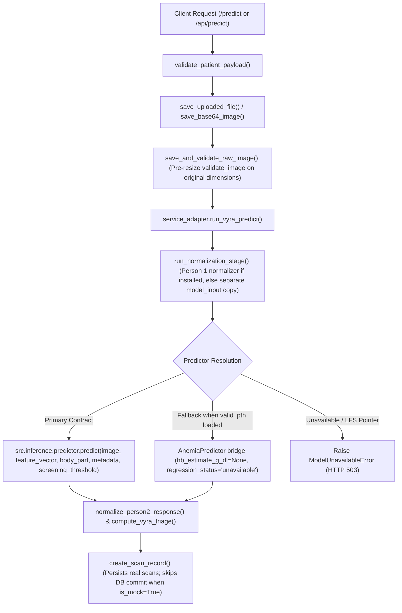

# VYRA — Person 3, Phase 3: Backend Integration Report (`PERSON3_PHASE3_REPORT.md`)

**Date:** 2026-10-23  
**Role:** Person 3 — Backend Integration, Patient Intake, Image Workflow, Persistence & PDF Reporting  
**Repository:** `C:\Claude_projects\Vyra\anemia-detection` (branch `feature/vyra-integration` / `Tanish`)  
**Workspace Root:** `C:\Claude_projects\Vyra` (branch `Tanish`)

---

## 1. Files Inspected and Changed

### 1.1 Files Inspected
- **Phase 1 & Phase 2 Documentation:**
  - `C:\Claude_projects\Vyra\anemia-detection\PERSON3_PHASE1_BASELINE.md`
  - `C:\Claude_projects\Vyra\anemia-detection\PERSON3_PHASE2_ARCHITECTURE.md`
  - `C:\Claude_projects\Vyra\anemia-detection\PERSON3_PHASE2_API_CONTRACT.md`
  - `C:\Claude_projects\Vyra\anemia-detection\PERSON3_PHASE2_HANDOFF.md`
  - `C:\Claude_projects\Vyra\PERSON_3_INTEGRATION_SPEC.md` (Person 2's integration specification)
- **Application & Model Source Files:**
  - `app.py`, `config.py`, `model.py`, `predict.py`, `image_validator.py`, `gradcam.py`, `pdf_report.py`, `schema_patches.py`, `storage_utils.py`, `api/index.py`
  - `models/20260428_2028_best_model.pth`, `models/20260428_2028_last_checkpoint.pth`, `models/temperature_scaling.json`
  - `templates/base.html`, `templates/index.html`, `templates/scan.html`, `templates/result.html`, `templates/about.html`, `templates/history.html`, `templates/analytics.html`
  - `static/js/upload.js`, `static/js/analytics.js`, `static/js/main.js`

### 1.2 Files Created or Modified
| File Path | Action | Summary of Changes |
| :--- | :--- | :--- |
| `service_adapter.py` | **Created** | Dedicated backend integration adapter implementing Person 2's `src.inference.predictor.predict` call path, pre-resize raw image validation, Person 1 normalization boundary, 13-field response contract validation, conservative provisional triage (`RED` / `YELLOW` / `GREEN`), Git LFS readiness inspection, and production-blocked development mock safeguards. |
| `tests/test_phase3_integration.py` | **Created** | Automated `pytest` suite covering all 17 required Phase 3 verification scenarios. |
| `PERSON_3_INTEGRATION_SPEC.md` | **Mirrored** | Copied from `C:\Claude_projects\Vyra\PERSON_3_INTEGRATION_SPEC.md` into `C:\Claude_projects\Vyra\anemia-detection\PERSON_3_INTEGRATION_SPEC.md`. |
| `PERSON3_PHASE3_REPORT.md` | **Created** | Phase 3 backend integration report (saved in repository and mirrored in workspace root). |
| `model.py` | **Modified** | Added `is_lfs_pointer_file()` and `inspect_checkpoint_file()`; updated `load_checkpoint()` to detect and reject Git LFS pointer files before `torch.load()`; updated `latest_available_checkpoint(require_valid=...)`. |
| `schema_patches.py` | **Modified** | Extended `apply_schema_patches()` to idempotently add Phase 3 columns (`is_mock`, `model_version`, `calibration_status`, `hb_estimate_g_dl`, `regression_status`, `anatomical_modality`, `triage_level`, `ita_angle`, `ita_category`, `glare_fraction`, `normalized_image_path`, `quality_warnings_json`) alongside `deleted_at`. |
| `predict.py` | **Modified** | Removed fabricated binary-to-Hb string ranges (`"7-9 g/dL (estimated)"`) from `estimate_hemoglobin_range()`; returns numeric Hb only when `regression_status == "validated"` and `hb_estimate_g_dl is not None`. |
| `app.py` | **Modified** | Integrated `service_adapter.py`; fixed pre-validation resize bug in `save_uploaded_file()` and `save_base64_image()`; added Phase 3 `Scan` columns and `is_mock` filtering in `scans_active_query()`; updated `/health`, `/predict`, and `/api/predict` readiness/error reporting; removed hardcoded `DEFAULT_CLINICAL_ACCURACY = 92.4`; added real modality counts (`image_type_bar`) in `analytics_payload()`. |
| `pdf_report.py` | **Modified** | Updated PDF report generation to respect the validated Hb readout rule, display `calibration_status` and provisional `triage_level`, and print the required prototype CBC disclaimer. |
| `api/index.py` | **Modified** | Removed fabricated `99.7%` benchmark metrics in `performance_overview()` and aligned `DISCLAIMER_TEXT` and `analytics_payload()`. |
| `static/js/upload.js` | **Modified** | Updated `bindModelReadiness()` so permanent checkpoint/LFS failures immediately transition to `"Model Unavailable"` (`model-readiness-card--offline`), stop polling, and never leave `#submitScanButton` permanently disabled. |
| `static/js/analytics.js` | **Modified** | Replaced hardcoded `0.58 / 0.34 / 0.08` modality multipliers with real database counts from `payload.image_type_bar`. |
| `templates/index.html` | **Modified** | Removed `10,000+` scan-count fallback on empty DB (`0` scans shown when DB is empty) and rendered `"Unavailable"` when evaluation metrics are absent. |
| `templates/about.html` | **Modified** | Rendered `"Unavailable"` for accuracy, sensitivity, specificity, and AUC-ROC when no evaluation artifact is present; updated clinical caveats with the required prototype disclaimer. |
| `templates/result.html` | **Modified** | Added prototype CBC disclaimer, calibration status label, model version, modality, and provisional triage readout when available. |
| `templates/scan.html` | **Modified** | Updated readiness banner conditions so Git LFS pointer checkpoints display `"Model Unavailable"` with the specific reason rather than `"Model Loading"`. |

---

## 2. Integration Architecture and Actual `predict()` Call Path



### Actual `predict()` Invocation in `service_adapter.py`
`service_adapter.run_vyra_predict()` resolves `src.inference.predictor.predict` lazily via `resolve_person2_predict_callable()` (avoiding import-time crashes when `src/` or weights are absent) and invokes:

```python
raw_result = active_predict_fn(
    image=str(normalized_stage.model_input_path),
    feature_vector=validated_feature_vector,  # 27-dim float list when confirmed, else None
    body_part=canonical_body_part,            # "conjunctiva" or "fingernail"
    metadata=metadata,                        # {"age": 24, "sex": "F"} (no PII logged)
    screening_threshold=resolved_threshold,   # 0.50 default, or 0.255 in high-sensitivity mode
)
```

- **Current Repository State:** Neither `src/inference/predictor.py` nor `normalization.py` has been committed to the repository yet by Person 2 or Person 1, and `models/20260428_2028_best_model.pth` / `models/20260428_2028_last_checkpoint.pth` remain 134-byte Git LFS pointer files. Consequently, live non-mock inference returns a clean `503 Service Unavailable` with `failure_category: "lfs_pointer_checkpoint"`, while the full adapter contract is verified against controlled test doubles and synthetic PyTorch checkpoints.

---

## 3. Verified Response-Field Mapping

| Person 2 Contract Field | Validation & Mapping Behavior in `service_adapter.py` | DB Column (`scans`) | Application / UI Behavior |
| :--- | :--- | :--- | :--- |
| `hb_estimate_g_dl` | Finite `float` in `[1.0, 25.0]` kept **only** when `regression_status == "validated"`; otherwise suppressed to `None` with warning. | `hb_estimate_g_dl` | Displayed as `"X.XX g/dL"` only when `hb_regression_available == True`; otherwise shows `"Continuous Hb estimate unavailable for this modality. Screening based on calibrated risk classification."` |
| `regression_status` | Must be `"validated"` or `"unavailable"`; defaults to `"unavailable"` if missing or unrecognized. | `regression_status` | Controls `hb_regression_available` and Hb display suppression. |
| `anemia_probability` | Finite `float` in `[0.0, 1.0]` or `None`; out-of-range/malformed values are discarded (`None`) with a warning. | `anemic_probability` | Mapped to `anemia_probability`, `anemic_probability`, `non_anemic_probability = 1 - p`, and `confidence`. |
| `predicted_class` | Canonical `"anemic"`, `"non-anemic"`, or `None` (derived from `anemia_probability >= screening_threshold` if omitted). If both `predicted_class` and `anemia_probability` are invalid/missing, raises `ContractValidationError`. | `prediction` (`"Anemic"` / `"Non-Anemic"`) | Drives verdict card and risk metadata. |
| `model_version` | Actual non-empty version string or `"unknown"`. | `model_version` | Stored on `Scan`, returned in JSON, and shown on `/result/<id>`. |
| `calibration_status` | `"calibrated"` or `"uncalibrated"`; defaults to `"uncalibrated"` if missing/invalid (never labels uncalibrated output as calibrated). | `calibration_status` | Preserved in JSON, DB, `/result/<id>`, and PDF report. |
| `quality_warnings` | Coerced to `list[str]` and merged with `image_validator.py` and normalization warnings. | `quality_warnings_json` | Exposed as `quality_warnings` and `warnings` in API responses. |
| `error` | Non-empty `error` raises `PredictionExecutionError` (`502`) and prevents saving a false success. | *(Not saved)* | Returned as structured error response without DB persistence. |
| `anatomical_modality` | Validated canonical `"conjunctiva"` or `"fingernail"`. | `anatomical_modality`, `image_type` | Mapped from UI `"Eye Conjunctiva"` / `"Fingernail"` or API `body_part`; unsupported values rejected (`400`). |
| `ita_angle` | Finite `float` in `[-90.0, 90.0]` or `None` (never invented). | `ita_angle` | Stored and returned as `float` or `null`. |
| `ita_category` | Valid Fitzpatrick tier (`Very Light`, `Light`, `Intermediate`, `Tan`, `Brown`, `Dark`) or `None`. | `ita_category` | Stored and returned as `str` or `null`. |
| `glare_fraction` | Finite `float` in `[0.0, 1.0]` or `None`. | `glare_fraction` | Stored and returned as `float` or `null`. |
| `processing_time_ms` | Non-negative `int` or measured elapsed ms. | *(Transient)* | Returned in API response. |
| `triage` *(Application field)* | Computed by `compute_vyra_triage()` (`RED`, `YELLOW`, `GREEN`, or `None` when required inputs for `GREEN` are missing). | `triage_level` | Marked `provisional: True` (`rule_status: "provisional_pending_clinical_signoff"`). |

---

## 4. Checkpoint / Model Readiness Findings

1. **Current Checkpoint Files Verified:**
   - `models/20260428_2028_best_model.pth`: **134 bytes**, Git LFS pointer (`version https://git-lfs.github.com/spec/v1`, `oid sha256:41f57795...`, `size 51481557`).
   - `models/20260428_2028_last_checkpoint.pth`: **134 bytes**, Git LFS pointer (`version https://git-lfs.github.com/spec/v1`, `oid sha256:0024998c...`, `size 144510291`).
2. **Readiness Protections Implemented:**
   - `model.is_lfs_pointer_file()` and `model.inspect_checkpoint_file()` inspect header bytes and file size (`>= 1024` bytes) before `torch.load()` is ever called.
   - `model.load_checkpoint()` raises a descriptive `RuntimeError` immediately when given a Git LFS pointer file instead of crashing with `_pickle.UnpicklingError: invalid load key, 'v'.`.
   - `/health` distinguishes `checkpoint_exists: true`, `checkpoint_is_lfs_pointer: true`, `checkpoint_valid: false`, `checkpoint_available: false`, `predictor_loaded: false`, `model_ready: false`, and `failure_category: "lfs_pointer_checkpoint"`.

---

## 5. Image Validation and Preprocessing Changes

1. **Fixed Pre-Validation Resize/Crop Defect:**
   - Previously, `save_uploaded_file()` and `save_base64_image()` called `optimize_and_save_image()`, which executed `ImageOps.fit(optimized, (224, 224))` **before** `validate_image()` ran—upscaling tiny images (`<100x100`) so they bypassed validation and center-cropping away surrounding tissue before normalization.
   - Now, `save_uploaded_file()` and `save_base64_image()` enforce extension and byte-size limits first, decode the image with lossless EXIF transpose (`save_and_validate_raw_image()`), save the **original uncropped image**, and run `validate_image()` on the original pixel dimensions before any resizing or cropping.
   - If `validate_image()` fails (e.g., `< 100x100` pixels or unreadable content), the file is deleted immediately and `ImageUploadValidationError` (`HTTP 400`) is raised.
2. **Separation of Raw vs. Normalized / Model-Input Files:**
   - `run_normalization_stage()` preserves `raw_image_path` untouched on disk and creates a separate `<stem>_normalized<ext>` (when Person 1's normalizer is active) or `<stem>_model_input<ext>` copy for downstream inference.

---

## 6. API and Health Endpoint Behavior

- **`GET /health`:**
  - Returns HTTP `200` with explicit readiness diagnostics (`model_ready`, `predictor_loaded`, `checkpoint_exists`, `checkpoint_valid`, `checkpoint_available`, `checkpoint_is_lfs_pointer`, `failure_category`, `status_message`, `person2_predictor_available`, `person1_normalizer_available`, `mock_mode_enabled`).
- **`POST /api/predict` & `POST /predict`:**
  - Validates patient intake fields (`patient_name`, `age`, `gender`, `body_part` / `image_type`, `screening_threshold`, `high_sensitivity_mode`) and raw image upload quality first (`HTTP 400` on invalid input).
  - When real inference is unavailable (missing checkpoint or Git LFS pointer), returns `HTTP 503` with `failure_category: "lfs_pointer_checkpoint"` (or `"missing_checkpoint"`) and a clear error message—never claiming `"The AI model is still starting on this server"`.
  - Frontend polling in `static/js/upload.js` detects `checkpoint_valid === false` / `failure_category`, updates the status badge to `"Model Unavailable"`, stops polling, and keeps `#submitScanButton` enabled so a failed health check never traps the UI.

---

## 7. Database and PDF Compatibility Findings

- **Database Schema (`schema_patches.py` & `Scan` model):**
  - Added 12 additive columns to `scans` via idempotent `ALTER TABLE` statements (`is_mock`, `model_version`, `calibration_status`, `hb_estimate_g_dl`, `regression_status`, `anatomical_modality`, `triage_level`, `ita_angle`, `ita_category`, `glare_fraction`, `normalized_image_path`, `quality_warnings_json`).
  - Existing row (`id=1`, `Rahul Parmar`) remains intact and queryable across `/`, `/history`, `/result/1`, `/history/export/csv`, `/analytics`, and `/export/pdf/1`.
  - `scans_active_query()` filters `or_(Scan.is_mock.is_(False), Scan.is_mock.is_(None))` so mock/test scans are excluded from history, CSV export, homepage counters, and analytics.
- **PDF Report Generation (`pdf_report.py`):**
  - Preserves ReportLab A4 PDF generation (`%PDF` verified in `test_15`), displays numeric Hb only when `regression_status == "validated"`, displays calibration status and provisional triage tier when available, and prints the required prototype CBC disclaimer in the footer.

---

## 8. Tests Executed and Exact Pass/Fail Results

Command executed:
```powershell
& "C:\Claude_projects\Vyra\anemia-detection\.venv\Scripts\python.exe" -m pytest C:\Claude_projects\Vyra\anemia-detection\tests\test_phase3_integration.py -v
```

| # | Test Name | Scenario Verified | Result |
| :--- | :--- | :--- | :--- |
| 1 | `test_01_app_startup_when_weights_missing` | Flask application startup when model weights are missing | **PASSED** |
| 2 | `test_02_valid_model_readiness_when_checkpoint_loads` | Valid model readiness when an actual PyTorch checkpoint loads | **PASSED** |
| 3 | `test_03_git_lfs_pointer_detection` | Detection of Git LFS pointer checkpoint files before `torch.load` | **PASSED** |
| 4 | `test_04_health_accurately_reports_readiness` | `/health` accurately reporting LFS pointer & model readiness | **PASSED** |
| 5 | `test_05_predict_returns_503_when_model_unavailable` | `/api/predict` returning HTTP 503 with clear reason when unavailable | **PASSED** |
| 6 | `test_06_successful_adapter_integration_with_person2_schema` | Adapter integration with controlled test double returning Person 2 schema | **PASSED** |
| 7 | `test_07_handling_missing_null_malformed_or_out_of_range_fields` | Safe handling of missing, `null`, malformed, or out-of-range fields | **PASSED** |
| 8 | `test_08_hb_readout_suppressed_when_unvalidated_or_unavailable` | Numeric Hb readout suppressed when `regression_status != "validated"` | **PASSED** |
| 9 | `test_09_tiny_images_rejected_before_resize` | Original tiny (`60x60`) images rejected before any resize/crop | **PASSED** |
| 10 | `test_10_corrupt_unsupported_unreadable_and_large_uploads` | Corrupt, unsupported, invalid base64, and oversized uploads rejected (`400`) | **PASSED** |
| 11 | `test_11_original_upload_separate_from_normalized_and_model_input` | Original `420x280` upload preserved separately from `224x224` normalized image | **PASSED** |
| 12 | `test_12_modality_mapping_and_rejection_of_unsupported_values` | Mapping of `conjunctiva` / `fingernail` and rejection of unsupported modalities | **PASSED** |
| 13 | `test_13_mock_mode_disabled_by_default_and_blocked_in_production` | Dev mock mode disabled by default and blocked when `FLASK_ENV=production` / `RENDER=true` | **PASSED** |
| 14 | `test_14_mock_results_not_saved_or_mixed_into_real_analytics` | Mock results flagged `is_mock: true`, `persisted: false`, and excluded from DB counts | **PASSED** |
| 15 | `test_15_database_history_csv_media_and_pdf_workflows` | End-to-end DB persistence, `/result/<id>`, `/history`, CSV, media, and PDF export | **PASSED** |
| 16 | `test_16_triage_never_assigns_green_when_inputs_missing` | `compute_vyra_triage()` never assigns `GREEN` when validated Hb or probability is missing or conflicting | **PASSED** |
| 17 | `test_17_no_hardcoded_performance_metrics_or_fabricated_counts` | Hardcoded `92.4%` / `99.7%` accuracy and `10,000+` scan counts removed; shows `Unavailable` | **PASSED** |

**Total:** `17 passed, 0 failed`

---

## 9. Known Issues and Remaining Blockers

1. **Missing Real PyTorch Weights (Person 2 Dependency):**
   - `models/20260428_2028_best_model.pth` and `models/20260428_2028_last_checkpoint.pth` are still 134-byte Git LFS pointers, and `src/inference/predictor.py` has not yet been committed to the repository. Live non-mock inference remains visibly unavailable (`HTTP 503`) until Person 2 delivers the trained checkpoint and `src/inference/predictor.py`.
2. **Missing Optical Normalization Module (Person 1 Dependency):**
   - `normalization.py` (or `src/preprocessing/normalization.py`) is not yet present in the repository. `service_adapter.run_normalization_stage()` currently uses the documented temporary boundary that preserves the original upload, creates a separate model-input copy without destructive center-cropping, and leaves `feature_vector`, `ita_angle`, `ita_category`, and `glare_fraction` as `None`.
3. **Missing Evaluation Artifacts (`logs/evaluation/test_summary.json`):**
   - Neither `logs/evaluation/test_summary.json` nor `logs/final_test_summary.json` exists yet; `/` and `/about` now honestly display `"Unavailable"` until Person 2 generates real evaluation artifacts.

---

## 10. Exact Steps Required to Run the App and Tests

### Run Automated Phase 3 Tests
```powershell
cd C:\Claude_projects\Vyra\anemia-detection
& "C:\Claude_projects\Vyra\anemia-detection\.venv\Scripts\python.exe" -m pytest tests\test_phase3_integration.py -v
```

### Run the Flask Application Locally
```powershell
cd C:\Claude_projects\Vyra\anemia-detection
& "C:\Claude_projects\Vyra\anemia-detection\.venv\Scripts\python.exe" app.py
```
Then open `http://127.0.0.1:5000` (or `http://127.0.0.1:5000/health` to inspect readiness JSON).

---

## 11. Questions Still Requiring Person 1 or Person 2

1. **For Person 1 (Optical Normalization & 27-Dim Feature Vector):**
   - What is the exact module path and function signature for the normalization pipeline (`normalization.normalize_image(image, body_part)` vs `src.preprocessing.normalization`), and what is the confirmed ordering of the 27-dimensional feature vector?
   - Does `src.inference.predictor.predict()` call Person 1's normalization internally when `feature_vector=None`, or should `service_adapter.py` always invoke Person 1's normalizer first and pass both the normalized image and `feature_vector`?
2. **For Person 2 (Model Checkpoint, Grad-CAM & Provisional Triage Thresholds):**
   - When will `src/inference/predictor.py` and the real `.pth` checkpoint artifact (`vyra-dualhead-efficientnet-b3-v1.0`) be committed or provided to replace the 134-byte Git LFS pointer files?
   - Does `src.inference.predictor.predict()` also return a `gradcam_path` (or expose the underlying `nn.Module` for `gradcam.py`), or should Grad-CAM generation be invoked via a separate helper in `src.inference.predictor`?
   - Are the provisional triage thresholds in `PERSON_3_INTEGRATION_SPEC.md` (`RED: Hb < 7.0 or prob > 0.85`, `YELLOW: 7.0 <= Hb < 11.0 or prob >= 0.50`, `GREEN: Hb >= 11.0 and prob < 0.50`, High-Sensitivity threshold `0.255`) finalized for the demo population, and what should the UI display for triage on fingernails where `hb_estimate_g_dl` is always `null` and `anemia_probability < 0.50`?
